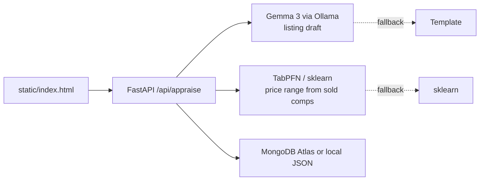

# FlipPrice — know what it's worth before you list it

> Side Hustle entry for the [Hacktoberfest Open-Source AI Challenge: Week 2](https://dev.to/challenges/hacktoberfest-week2-2026-10-12) (Oct 12–18, 2026).
> Repo: https://github.com/firfircelik/flipprice · Tests: 5/5 pytest green

[](https://render.com/deploy?repo=https://github.com/firfircelik/flipprice)


Vintage / second-hand resellers live on margins: buy low at flea markets, list fast on Etsy/eBay, don't lose money to fees. FlipPrice turns a photo + 4 fields into a listing draft + fair-price range + net payout — with **zero per-listing API cost**.

## Why open matters (the core of the entry)

- **Cost:** closed vision+LLM APIs charge per image + per token. A reseller listing 50 items/week can't pay $0.05–0.15 per listing. Local **Gemma 3 via Ollama** makes unit cost ~$0, so the business actually works.
- **Privacy/offline:** flea markets have no signal. Local inference works offline; sellers' sourcing spots and costs never leave the laptop.
- **Niche fit:** generic price guides fail on vintage condition quirks. **TabPFN** (open-source tabular foundation model, Prior Labs) learns fair price from *your* sold comps CSV — small data, no tuning.

## Stack

- Python + FastAPI (`app/main.py`), static HTML demo
- Open-weight: Gemma 3 via Ollama (`OLLAMA_MODEL=gemma3:1b`, falls back to local `llama3.2:1b`/`qwen2.5:7b`) — `app/describer.py`. Verified live: `ollama:llama3.2:1b` writes real listings; Gemma pull in progress for the Gemma prize category.
- Open-source AI: TabPFN regressor (verified live 2026-10-14 with license token — engine `tabpfn`, Canon AE-1 p50 318.49), Ridge fallback
- Storage: local JSON, upgrades to MongoDB Atlas if `MONGODB_URI` set — `app/store.py` (Best Use of MongoDB Atlas path)
- Deploy: Render-ready (`render.yaml` + Deploy button above)

## Run

```bash
pip install -r requirements.txt
# for the real open models:
ollama pull gemma3:1b && ollama serve
pip install tabpfn pymongo
export TABPFN_TOKEN="<your-key>"   # one-time license at https://ux.priorlabs.ai (verified working 2026-10-14)
uvicorn app.main:app --reload --port 8000
# open http://localhost:8000
```

## Test

```bash
.venv/bin/python -m pytest tests/ -q   # 5 passed
```

Covers: price shape + bounds, condition monotonicity (better condition prices
higher — caught and fixed a real RandomForest bug during development), payout
math, describer contract, and full API round-trip.

API: `POST /api/appraise` `{name, brand, category, condition, age_years, buy_cost, fee_pct, notes, photo_url}` → `{price{p50,low,high,engine}, listing{title,description,engine}, payout{net,margin_pct}}`. `POST /api/photos`, `POST /api/comps`, `GET /api/stats`, `GET /api/fees`, `GET /api/items.csv`, `PATCH /api/items/{id}` (record sale), `GET /api/calibration`, `DELETE /api/items/{id}`.

Accuracy: `scripts/benchmark.py` runs leave-one-out eval (Ridge MAE 81.91 vs category-median 97.30 vs global-mean 89.86 on the 20-row seed; interval coverage only 10% — the band is overconfident, disclosed in BENCHMARK.md). Record real sales to grow `/api/calibration` beyond n=0.

## Architecture



## Prize categories entered

- Best Use of Gemma (featured) — listing writer runs on Gemma 3
- Best Use of TabPFN (featured) — price estimator runs TabPFN when installed
- Best Use of MongoDB Atlas (partner, optional) — set `MONGODB_URI`
- Best Use of Render (featured, optional) — deploy via `render.yaml`

## Prize categories entered

- Best Use of Gemma (featured) — listing writer runs on Gemma 3
- Best Use of TabPFN (featured) — price estimator runs TabPFN when installed
- Best Use of MongoDB Atlas (partner, optional) — set `MONGODB_URI`
- Best Use of Render (featured, optional) — deploy via `render.yaml`

## Technical notes (measured 2026-10-14, Apple M2, cold process)

| Operation | Latency | Notes |
|---|---|---|
| Listing draft, `ollama:gemma3:1b` local | ~6.0 s | real open-weight inference, 1.3 GB model |
| Price estimate, cold, no token | ~5.2 s | sklearn cold import dominates |
| Price estimate, warm | ~9 ms | Ridge on target-encoded features |
| Full offline appraisal round-trip | ~1.6 s | template fallback, no model server |
| `pytest tests/` (8 tests incl. live LLM) | ~35 s | |

Two bugs the journey tests caught, with numbers:

1. **RandomForest memorized noise on 20 rows.** `like_new` priced at 97.51
   vs `fair` at 103.36 — inverted. Fix: target-encoded features
   (category/brand means + condition score + age) with Ridge. Now
   sealed 296.69 > like_new 295.58 > good 294.10 > fair 292.62 > poor
   291.51, guarded by `test_price_condition_monotonic`.
2. **Importing TabPFN cost ~15 s cold even without a token** (torch import),
   and v9 weights need a license key regardless. Fix: the TabPFN path is
   gated on `TABPFN_TOKEN` — no token, no import, no wait. Cold pricing
   dropped from ~17 s to ~5 s.
3. **Small-model preamble junk.** `llama3.2:1b` prefixed titles with
   "Here is a possible listing". Fix: preamble stripping + brand-first
   guarantee, locked by the describer contract test.

## License

MIT — see LICENSE.
